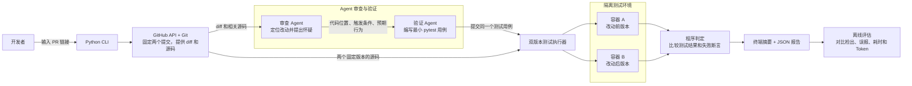

# pr-regression-agent
AI-powered PR review with reproducible tests to detect changes that break existing behavior.

## 需求概述

面向审查 Python PR 的开发者，检查代码改动是否破坏了已有功能，并提供可以重跑的测试证据。

- **第一版范围**：命令行接收 GitHub PR 链接，支持依赖可预装的 Python 仓库。固定改动前后的提交，按需读取 diff、相关代码和已有测试。
- **验证与报告**：对可疑行为编写最小 pytest 用例，在隔离环境中对两个版本运行同一个测试。报告记录代码位置、触发条件、提交 SHA、测试源码和结果。
- **验收标准**：覆盖功能被改坏、正常改动和无法验证三种情况。仅当旧版通过、新版在目标断言上失败时标为「已复现」。依赖缺失、超时等情况标为「待验证」。
- **评估方式**：用同一批人工标注的 PR，对比只看 diff、单 Agent 使用工具、双 Agent 协作三种方案，记录检出数、误报数、复现数、耗时和 Token 消耗。

## 粗架构图

下图展示双 Agent 模式。单 Agent 模式由同一个 Agent 完成审查和验证，复用 Git 工具、执行器和报告模块。

## PR Regression Agent 第一版 Implementation Plan

> **For agentic workers:** 执行时按用户选定的方式逐项实施，可使用 `superpowers:subagent-driven-development` 或 `superpowers:executing-plans`。用复选框记录进度。

**Goal** 给定 GitHub 上自有 Python 样例的 PR，产出可重跑的功能回归证据。

**Architecture** CLI 固定两个提交并提供代码上下文。审查流程提出功能回归假设，验证流程生成单个 pytest 用例，执行器在两个隔离容器中运行同一份用例，由程序判定结果并写入报告。

**Tech Stack** Python 3.11+、argparse、GitHub REST API、Git、Pydantic、Docker Linux 容器、pytest。

**Spec** [README 需求与粗架构图](https://github.com/liujiawei2006/pr-regression-agent/blob/ae4447fe9b1a07257b75fc80adf9b821d6e2cdbe/README.md)

### 全局约束

- CLI 接收 GitHub PR 链接。第一批只验证自有、依赖可预装的 Python 样例的功能行为。
- GitHub 返回的 base 和 head SHA 固定输入。用二者的共同祖先作为旧版，用 head 作为新版，报告记录实际运行的两个 SHA。
- 两个版本运行字节相同的用例。旧版通过且新版在目标断言上失败，才标为「已复现」。
- 依赖缺失、超时、测试未收集、目标断言无法确认等情况标为「待验证」。用例在两版均通过或审查无候选时，终端输出「本次未发现」。
- 模型仅访问固定提交的 diff 和相关文件。测试运行限时、断网，挂载只读源码和用例，使用临时可写目录。容器不接收宿主凭证、Docker socket 或额外宿主目录。

### 审查重点

| 输入或异常 | 预期 | 验收位置 |
| --- | --- | --- |
| base 分支在 PR 分叉后继续提交 | 基线使用共同祖先 | 任务 3 |
| 获取 PR ref 时 head 已变 | SHA 不符时停止验证并记录原因 | 任务 3 |
| 新版在目标断言之前抛出异常 | 待验证 | 任务 1、2 |
| pytest 只报告跳过或没有收集用例 | 待验证 | 任务 2 |
| 一个候选两版均通过，另一个候选无法执行 | 无已复现时汇总为待验证 | 任务 4 |

### 文件与职责

| 路径 | 职责 |
| --- | --- |
| `pyproject.toml`、`src/pr_regression/models.py` | 包入口、共享数据契约 |
| `examples/empty_retrieval/`、`src/pr_regression/judge.py` | 自有样例、判定规则 |
| `docker/Dockerfile`、`docker/pytest_probe.py`、`src/pr_regression/runner.py` | 预装依赖、测试事件与双版本执行 |
| `src/pr_regression/source.py` | PR 元数据、Git 快照和只读上下文 |
| `src/pr_regression/agents.py` | 三种模式共用的模型输入和结构化输出 |
| `src/pr_regression/cli.py`、`src/pr_regression/report.py` | 调度、终端摘要与 JSON |
| `evaluation/cases.json`、`evaluation/run.py` | 人工标注和对照评估 |

### 任务 1 · 用手写样例固定验收和判定规则

**接口** `judge(before: RunResult, after: RunResult) -> Status`。在 `models.py` 定义 `RunResult(outcome, duration_ms, detail)`，其中 `outcome` 取 `pass`、`target_assertion_failed`、`unverified`。定义 `Status` 为三个中文状态的字面量类型。

- [ ] 在 `tests/test_judge.py` 写参数化用例，断言 `judge(pass_result, target_failure) == "已复现"`、`judge(pass_result, pass_result) == "本次未发现"`、`judge(pass_result, unverified_result) == "待验证"`、`judge(target_failure, target_failure) == "待验证"`。
- [ ] 运行 `python -m pytest tests/test_judge.py -q`，确认判定尚未实现时失败。
- [ ] 实现共享结果类型与判定。新增自有空检索样例，手写一个测试，从公开问答入口传入空检索结果，断言用户可见回复包含固定短语 `资料不足`。把三个样例的版本分别设计为旧版有提示且新版丢失提示、两版都有提示、新版导入依赖失败。
- [ ] 运行同一条 pytest 命令，判定用例全部通过。
- [ ] 单独提交样例、类型和判定。

### 任务 2 · 实现双版本执行器

**接口** `run_pair(before_dir: Path, after_dir: Path, test: TestCase, *, image: str, timeout_s: int) -> tuple[RunResult, RunResult]`。`TestCase(source: str, node_id: str, assertion_line: int)`，目标行号从 1 开始，指向用例文件内的目标 `assert`。

- [ ] 在 `tests/test_runner.py` 增加 Docker 集成测试，断言三个样例的结果依次为 `("pass", "target_assertion_failed")`、`("pass", "pass")`、`("pass", "unverified")`。参数化测试另覆盖跳过、未收集、目标行之前异常和超时，断言均为 `unverified`。校验两个容器接收同一测试文件内容。
- [ ] 运行 `python -m pytest tests/test_runner.py -q`，确认执行器接口缺失时在收集阶段失败。
- [ ] 实现 `run_pair`。镜像预装 pytest 与样例依赖，默认时限由 CLI 设为 30 秒/版本。pytest 插件输出指定 node ID 的 setup、call、teardown 结果与失败位置。只有 setup 和 teardown 正常且 call 的失败来自用例目标行的 `AssertionError` 才给出 `target_assertion_failed`。通过需三个阶段均通过。超时后清理对应容器。
- [ ] 运行 `docker build -t pr-regression-test -f docker/Dockerfile .` 后重跑上述测试，全部通过。
- [ ] 单独提交执行器、镜像和集成测试。

### 任务 3 · 固定 PR 提交并提供上下文

**接口** `read_pr(url: str) -> PullRequest`；`checkout_pr(pr: PullRequest, directory: Path) -> RevisionPair`；`read_context(pair: RevisionPair, revision: Literal["before", "after"], path: str) -> str`。`PullRequest` 包含 `owner, repo, number, base_sha, head_sha`。`RevisionPair` 包含 `before_sha, after_sha, before_dir, after_dir, diff`。

- [ ] 在 `tests/test_source.py` mock GitHub API 并用本地 Git 历史测试。断言 `pair.before_sha == fork_point_sha`、`pair.after_sha == api_head_sha`。ref 移动导致 head 不符时，断言抛出 `SourceError("PR head changed")`。无效 URL 和越界路径各有一个拒绝用例。
- [ ] 运行 `python -m pytest tests/test_source.py -q`，确认接口缺失时失败。
- [ ] 实现 `source.py`。解析 `https://github.com/OWNER/REPO/pull/NUMBER`，从 GitHub REST API 读取元数据。获取对象后核对 SHA，再计算 merge base，导出两个独立快照和这两个 SHA 的 diff。路径读取限制在对应快照内，拒绝越界链接。Git 命令使用参数数组。
- [ ] 重跑该测试，全部通过。
- [ ] 单独提交源码读取模块及测试。

### 任务 4 · 跑通 CLI、报告和三种审查模式

**接口** `review(pair: RevisionPair, mode: Mode, model: ModelClient) -> list[Candidate]`；`main(argv: Sequence[str] | None = None) -> int`；`write_report(report: Report, path: Path) -> None`。`Candidate(path, line, trigger, expected, suspected, test)`，其中 `test: TestCase | None`。`Mode` 取 `diff`、`single`、`dual`。模型适配器返回 Pydantic 校验后的结果及输入、输出 Token 用量。

- [ ] 在 `tests/test_cli.py` 注入假模型、PR 读取器和执行器。断言三种样例的终端摘要分别为三个中文状态，且 JSON 含 `before_sha`、`after_sha`、每个候选的文件行号、触发条件、预期、可疑行为、测试源码和执行结果。断言空候选输出 `本次未发现`，两版均通过的候选加一个未验证候选时输出 `待验证`。断言 `diff` 模式不会调用文件读取器或执行器。模拟 `SourceError("PR head changed")`，断言报告状态为 `待验证`、原因含 `PR head changed`，且未调用执行器。
- [ ] 运行 `python -m pytest tests/test_cli.py -q`，确认入口尚未接通时失败。
- [ ] 实现模式及 CLI。命令为 `pr-regression-agent PR_URL --mode {diff,single,dual} --image pr-regression-test --output report.json`，默认 `single`。`diff` 只产出候选，候选标为待验证。`single` 在一个模型会话中读取上下文并产出假设和用例。`dual` 由审查会话提出假设、验证会话生成用例。两种工具模式共用读取与执行接口。单 Agent 和双 Agent 的模型及总预算由同一配置指定。模型凭证留在宿主。报告汇总优先级为已复现、待验证、本次未发现，记录耗时和 Token。`checkout_pr` 抛出 `SourceError` 时输出「待验证」并在报告保留原因和可用的 PR 元数据，未取得的运行 SHA 留空。
- [ ] 重跑 CLI 测试。再对三个自有样例 PR 用真实 CLI 验收，核对两个 SHA、状态及报告中的证据。把命令、参数和验收方式补入 README。
- [ ] 单独提交 CLI、审查模式和报告。

### 任务 5 · 在同一批 PR 上跑对照评估

**接口** `summarize(cases: list[LabeledCase], reports: list[Report]) -> dict[str, Metrics]`。`LabeledCase` 保存 PR URL、预期 SHA 对、人工标签以及可匹配的预期行为。一个 PR 内同一预期行为只计一次。

- [ ] 在 `tests/test_evaluation.py` 构造固定报告，断言匹配的候选计 1 次检出，重复候选不加分，正常 PR 上的错误候选计 1 次误报，匹配且已复现的候选计 1 次复现。断言「待验证」样例单独统计，且 SHA 不符的报告不纳入该批。
- [ ] 运行 `python -m pytest tests/test_evaluation.py -q`，确认汇总模块缺失时失败。
- [ ] 实现 `evaluation/run.py`，从 `evaluation/cases.json` 读入同一批样例及标签，调用三个模式并保存原始报告。输出各模式的检出数、误报数、复现数、待验证数、耗时与 Token。单、双 Agent 固定相同模型、工具和总预算。
- [ ] 重跑评估测试。执行 `python evaluation/run.py --cases evaluation/cases.json`，检查三个模式使用相同的 PR 和 SHA 对，能从原始报告追溯统计值。
- [ ] 单独提交评估脚本和标签。
