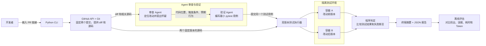

# pr-regression-agent
AI-powered PR review with reproducible tests to detect changes that break existing behavior.

## 需求概述

面向审查 Python PR 的开发者，检查代码改动是否破坏了已有功能，并提供可以重跑的测试证据。

- **第一版范围**：命令行接收 GitHub PR 链接，支持依赖可预装的 Python 仓库。固定改动前后的提交，按需读取 diff、相关代码和已有测试。
- **验证与报告**：对可疑行为编写最小 pytest 用例，在隔离环境中对两个版本运行同一个测试。报告记录代码位置、触发条件、提交 SHA、测试源码和结果。
- **验收标准**：覆盖功能被改坏、正常改动和无法验证三种情况。仅当旧版通过、新版在目标断言上失败时标为「已复现」。依赖缺失、超时等情况标为「待验证」。
- **评估方式**：用同一批人工标注的 PR，对比只看 diff、单 Agent 使用工具、双 Agent 协作三种方案，记录检出数、误报数、复现数、耗时和 Token 消耗。

## 粗架构图

下图展示双 Agent 模式。单 Agent 模式由同一个 Agent 完成审查和验证，复用 Git 工具、执行器和报告模块。

